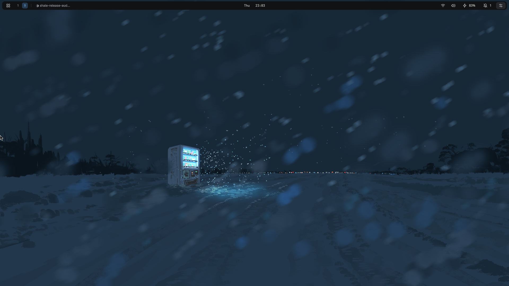
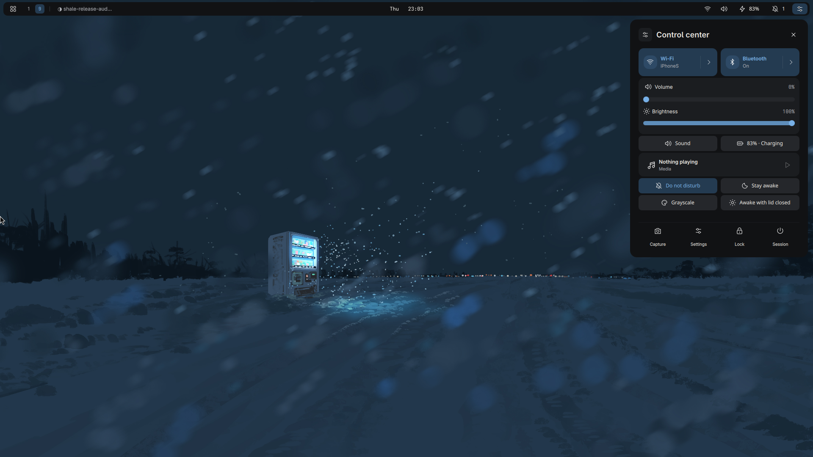
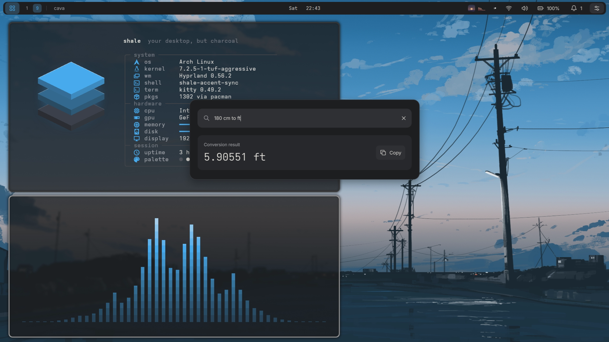
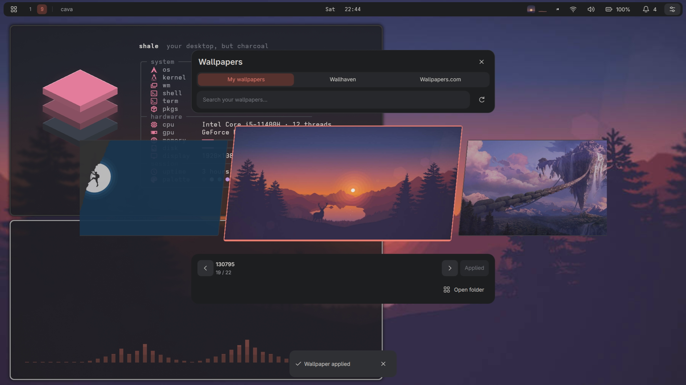
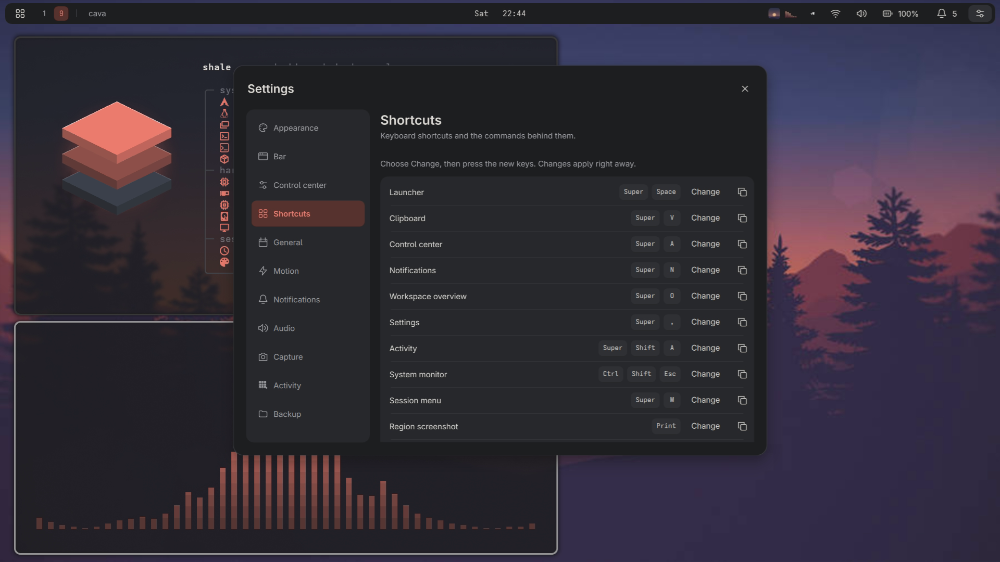

# Shale

A charcoal desktop shell for Hyprland, built with [Quickshell](https://quickshell.org): a compact top bar, animated panels and the everyday controls you'd otherwise need separate apps for.



| Control center | Launcher |
|---|---|
|  |  |
| **Wallpapers** | **Settings** |
|  |  |

## Features

- **Bar**: workspaces, window title, clock, media with a visualizer (optional `cava`), mic and screen-sharing indicator, tray, keyboard layout (with two or more), VPN, audio, Wi-Fi, battery and notifications. Tooltips on hover; can be hidden per output and over fullscreen apps.
- **Launcher**: apps with pins, open windows, actions (lock, restart, Wi-Fi, settings…), arithmetic (`6 * 7`), unit conversion (`10 km to mi`), `timer 10m tea`, `focus 40`, `:` emoji, `/` files, `?` web search, `>` run a command.
- **Control center**: Wi-Fi and NetworkManager VPN/WireGuard connections, Bluetooth with per-device auto-connect, per-app volume, microphone, brightness, power profiles, do not disturb, stay awake, media with an equalizer.
- **Notifications** with grouped history, actions and optional persistence.
- **Calendar** with weather from Open-Meteo (no API key).
- **Clipboard history** with image previews, color swatches and one-click opening of links and paths (cliphist).
- **Workspace overview** with window snapshots.
- **Wallpapers** from local folders, Wallhaven and Wallpapers.com, through hyprpaper, awww or swww. Accent color can follow the wallpaper.
- **Lock screen** with PAM (ext-session-lock): the time drawn in particles of light that gather, shift each minute and burst apart as you unlock, or a classic clock; hyprlock as an alternative.
- **Capture**: screenshots, screen recording with system audio or microphone, color picker.
- **Focus**: a timed session (25, 50 or 90 min, or `shale focus 40`) holds notifications and shows a countdown ring in the bar. When it ends, one card sums up what came in, grouped by app. Countdown timers too (`shale timer 10m Tea`).
- **Activity**: opt-in, local-only app usage history with a yearly heatmap.
- **Make it yours**: move, reorder or hide what the bar shows, pick its clock, workspace dots, tray icons and an edge-to-edge style; arrange the control center's tiles and buttons; change any shortcut by pressing the new keys; back up your settings to a file and bring them to another computer.
- **System monitor**: live CPU, memory, disks, network, GPUs, temperatures and fans (Ctrl+Shift+Esc), with the last five minutes already graphed when it opens. A sleeping laptop GPU is left asleep.

## Requirements

- Arch Linux
- Hyprland 0.56+ with a Lua config (`~/.config/hypr/hyprland.lua`); `hyprland.conf` isn't supported
- Quickshell 0.3.1+
- systemd user services and PipeWire

[dependencies.txt](dependencies.txt) lists the packages. Missing hardware (battery, backlight, Bluetooth, Wi-Fi) just hides the related controls.

Shale is the bar and the notification daemon, so remove waybar, mako, dunst, swaync and the like from your autostart.

## Install

```sh
git clone https://github.com/TurcanS/shale ~/src/shale && cd ~/src/shale
./install.sh
```

The installer shows the packages it wants (only the ones this machine needs) and installs them with `sudo pacman` after you confirm. Then it copies the shell to `~/.config/quickshell/shale`, adds `shale.lua` to `~/.config/hypr` with one line in `hyprland.lua` that loads it, and installs a `shale` command and a `shale.service` user unit. If one of Shale's shortcuts is already bound, it asks before replacing it. Every file it changes is backed up first.

It also works on a minimal Arch install: it adds Hyprland with its example config, portals, a polkit agent, fonts, a terminal, PipeWire and the SDDM login screen if there's none. It never replaces your network setup, power manager or wallpaper daemon, and doesn't pick GPU drivers.

Useful options: `--yes` (don't ask), `--no-packages` (shell only), `--no-login-screen`, `--wallpaper-shortcut` (binds Super+Shift+W), `--verbose`. `python3 scripts/install.py` previews the changes without writing anything.

Don't clone into `~/.config/quickshell/shale`; that's the install target.

To try it without installing: `quickshell --path shell.qml`.

### Update and uninstall

```sh
./install.sh --update       # git pull, reinstall, restart the shell
./install.sh --uninstall    # add --purge to also delete settings and history
```

When a new version is out, a dot appears on the control center button and the control center lists what changed; **Update now** runs `./install.sh --update` in a terminal. Shale asks GitHub every 12 hours; turn it off in Settings → General.

Uninstall puts back the files Shale replaced, removes the ones it added and takes only Shale's lines out of `hyprland.lua`, so your later edits stay. It doesn't remove packages; it prints the `pacman` command for the ones the installer added.

To undo a single install instead: `python3 scripts/install.py --rollback ~/.local/state/shale/backups/<backup> --apply`.

## Shortcuts

| Shortcut | Action |
|---|---|
| Super+Space | Launcher |
| Super+V | Clipboard |
| Super+A | Control center |
| Super+Shift+A | Activity |
| Ctrl+Shift+Esc | System monitor |
| Super+N | Notifications |
| Super+O | Overview |
| Super+, | Settings |
| Print / Shift+Print | Region / output screenshot |
| Super+Print | Capture and recording |
| Super+M | Session menu |
| Super+L | Lock |

To change one, open Settings → Shortcuts, choose Change and press the new keys; it works right away. Keys your Hyprland config already uses are refused, so nothing gets bound twice. The calendar, color picker, do not disturb, focus and closing a panel can get a shortcut there too.

Volume, brightness and media keys come from Hyprland's example config; Shale shows an OSD for them.

Everything is also a command: `shale launcher`, `shale system`, `shale screenshot region`, `shale page wifi`, `shale settings shortcuts`, `shale focus 50`, `shale dnd`, `shale lock`, `shale status`, `shale --version`. Run `shale help` for the list.

## Files

| | |
|---|---|
| Settings | `~/.config/shale/config.json` (Settings → Backup exports a copy) |
| Shortcuts changed in Settings | `~/.config/shale/shortcuts.lua`, read by `~/.config/hypr/shale.lua` |
| Activity, wallpaper choices, installer backups | `~/.local/state/shale/` |
| Cache | `~/.cache/shale/` |

Screenshots, recordings and wallpapers go to `Screenshots`, `Recordings` and `Wallpapers` in your XDG pictures and videos folders; change them in Settings.

Activity tracking is off until you turn it on in the Activity panel. It stores app IDs and time ranges (never window titles) in `activity.sqlite3`, and nothing leaves your machine.

## Power profiles

Power modes work with power-profiles-daemon or tuned-ppd. Shale also ships TuneD profiles that go further (turbo, EPP, platform profile; power saver also drops the refresh rate and turns off blur and shadows). They need the `intel_pstate` or `amd-pstate-epp` driver:

```sh
sudo pacman -S --needed tuned tuned-ppd
sudo systemctl enable --now tuned.service tuned-ppd.service
python3 scripts/install-power.py --apply
```

## Troubleshooting

- `shale logs` shows the journal, `shale restart` restarts the shell.
- Settings → Diagnostics lists the tools and services Shale found.
- If the shell won't start, your apps and hyprlock still work.
- New enterprise Wi-Fi networks need a NetworkManager profile created elsewhere. Brightness covers laptop backlights only.

## Development

`shell.qml` creates a bar, panel host and overlays per output. `core/ShellState.qml` routes panels and exposes the `shell` IPC target, `core/Theme.qml` holds colors and motion, and `services/Services.qml` wraps Quickshell's native services. Everything else (Wi-Fi, Bluetooth pairing, power profiles, capture, settings, activity) goes through one Python helper, `helpers/backend.py`, which `core/Backend.qml` talks to over JSON lines on stdin/stdout:

```json
{"id": 1, "method": "wifi.list", "params": {}}
{"id": 1, "ok": true, "result": {"networks": [], "powered": true}}
```

Checks:

```sh
python3 scripts/check-live.py --installed  # against the running shell
```

Spacing, sizes and colors come from `core/Theme.qml`, and shared controls (lists, segmented choices, groups) from `components/`. Icons are outline SVGs in `assets/icons`; after adding or editing one, run `python3 scripts/build-icons.py` to regenerate `core/icons.js`, which lets an icon take any color.

## Feedback

Bugs and feature requests go in [issues](https://github.com/TurcanS/shale/issues); questions, ideas and screenshots of your setup in [discussions](https://github.com/TurcanS/shale/discussions). Pull requests are welcome; run the checks above first.

## Credits

Weather by [Open-Meteo](https://open-meteo.com). Wallpapers from [Wallhaven](https://wallhaven.cc) and [Wallpapers.com](https://wallpapers.com); credit the artists when you share one.

MIT licensed, see [LICENSE](LICENSE).
