<div align="center">


# Shale

A charcoal desktop shell for Hyprland, built with [Quickshell](https://quickshell.org).<br>
A compact top bar, animated panels, desktop widgets and AirDrop: the everyday controls you'd otherwise need separate apps for.

[](https://github.com/TurcanS/shale/stargazers)
[](https://github.com/TurcanS/shale/commits/main)
[](https://hyprland.org)
[](https://quickshell.org)
[](LICENSE)

[Install](#install) · [Features](#features) · [Shortcuts](#shortcuts) · [AirDrop](#airdrop) · [Files](#files) · [Development](#development)

</div>

<br>


<table>
  <tr>
    <td width="50%" align="center">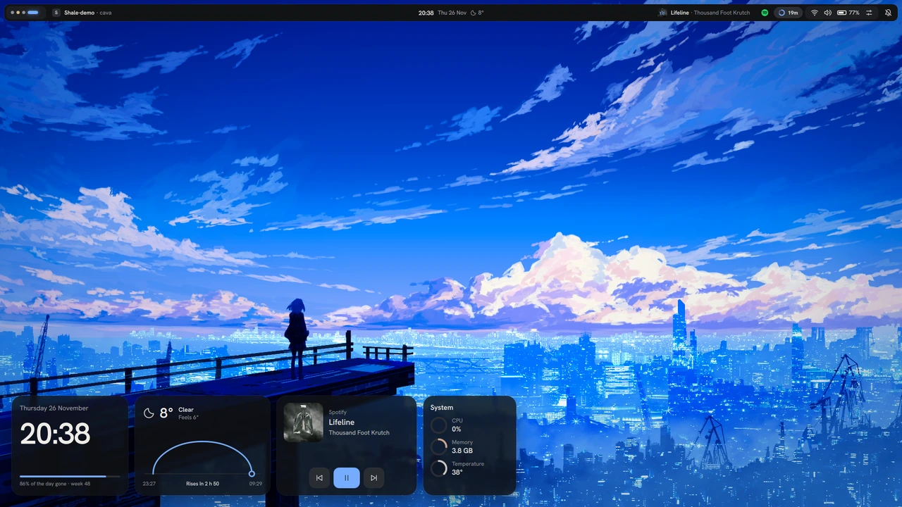<br><sub>Widgets: clock, sky, player and system on the desktop</sub></td>
    <td width="50%" align="center">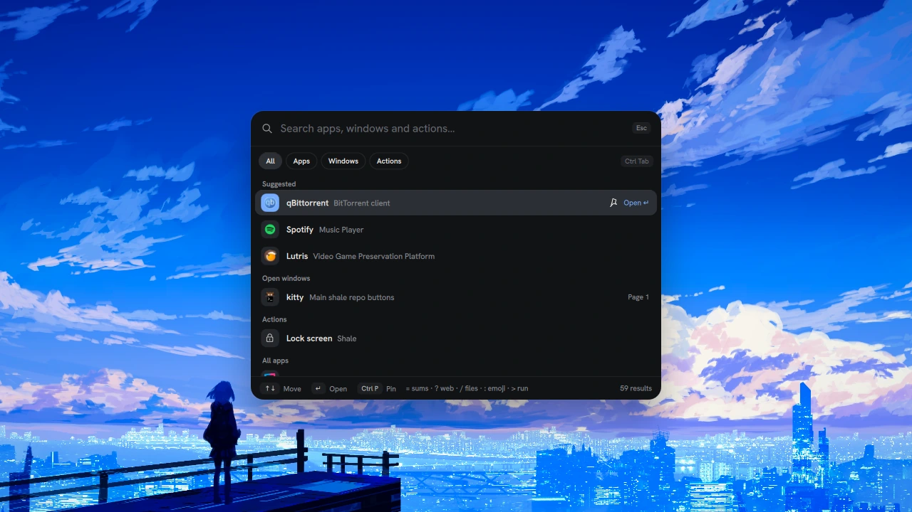<br><sub>Find: apps, windows, actions, sums and units</sub></td>
  </tr>
  <tr>
    <td width="50%" align="center">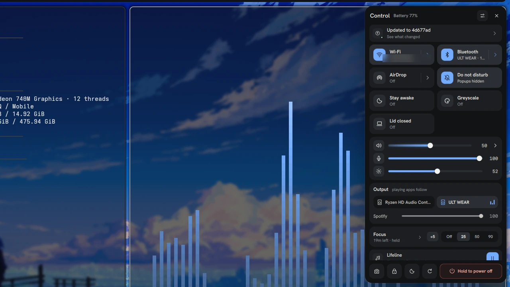<br><sub>Control: Wi-Fi, Bluetooth, sound and quick keys</sub></td>
    <td width="50%" align="center">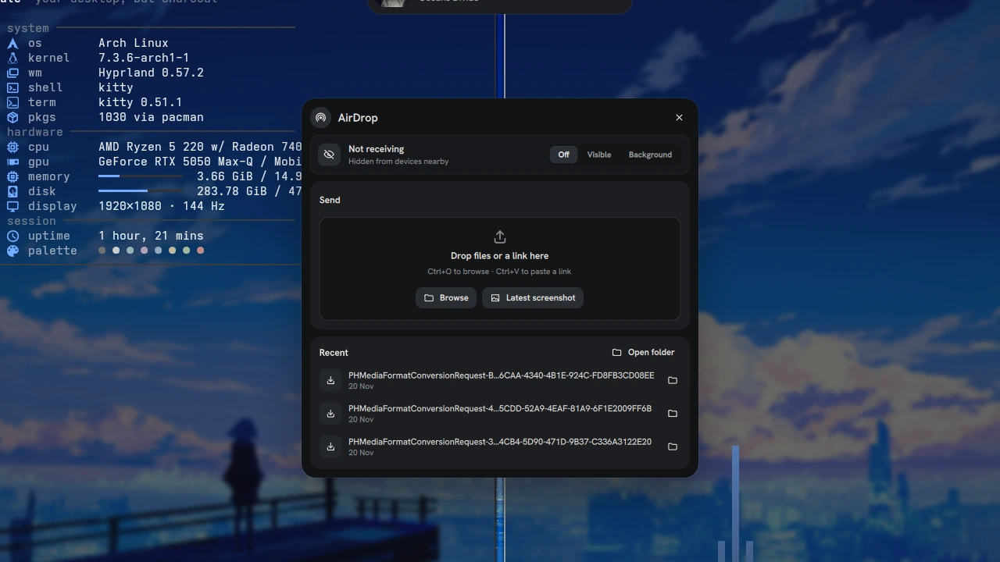<br><sub>AirDrop: send to iPhones and Macs nearby</sub></td>
  </tr>
  <tr>
    <td width="50%" align="center">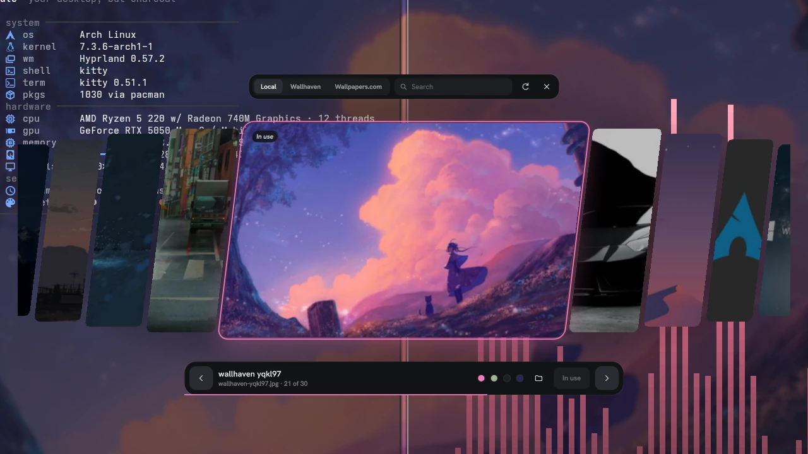<br><sub>Wallpapers: the accent follows the picture</sub></td>
    <td width="50%" align="center">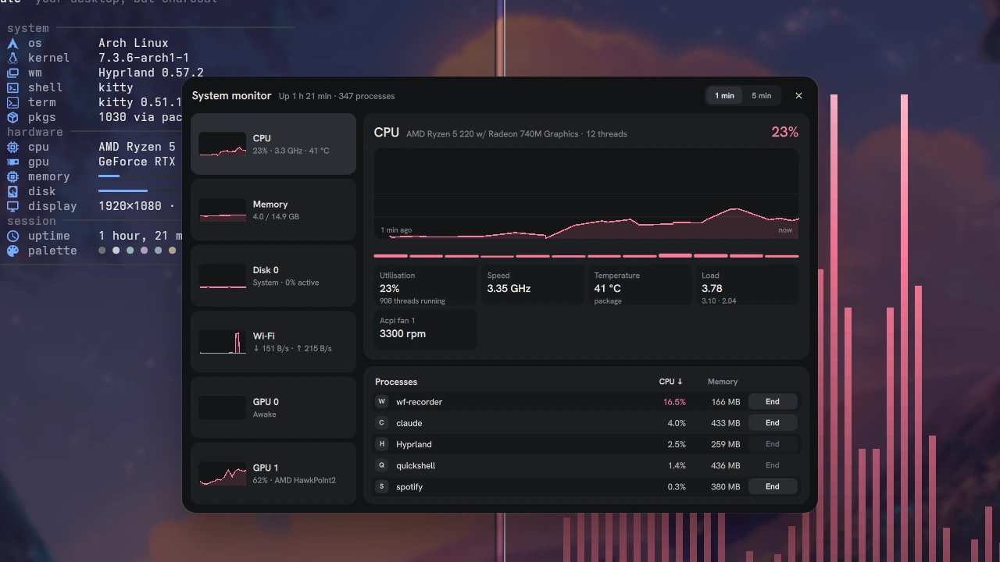<br><sub>System monitor</sub></td>
  </tr>
  <tr>
    <td width="50%" align="center">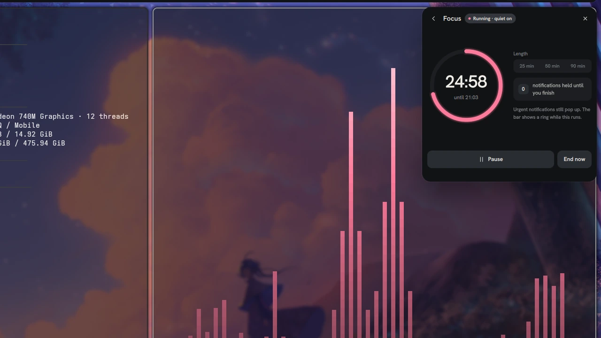<br><sub>Focus: a timed session that holds notifications</sub></td>
    <td width="50%" align="center">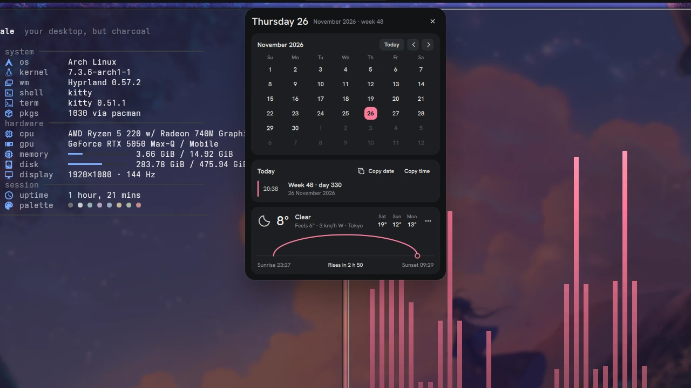<br><sub>Clock and sky: calendar and weather</sub></td>
  </tr>
  <tr>
    <td width="50%" align="center">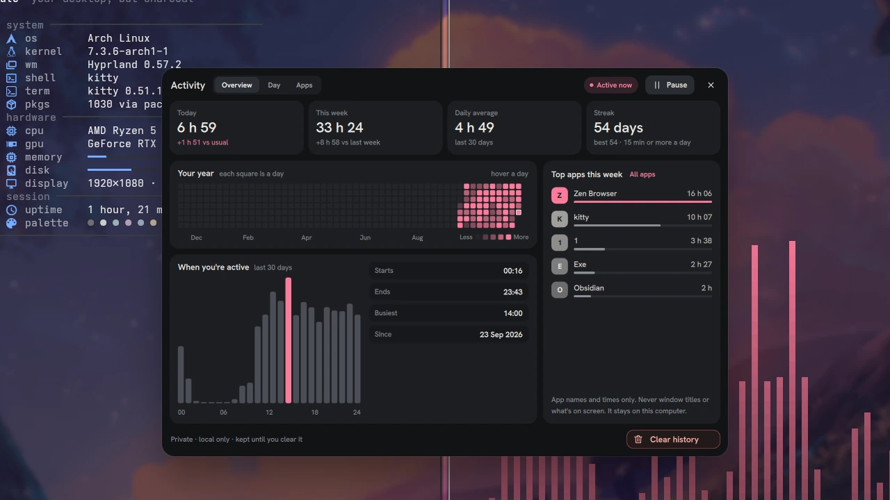<br><sub>Activity: your app history, kept on this computer</sub></td>
    <td width="50%" align="center">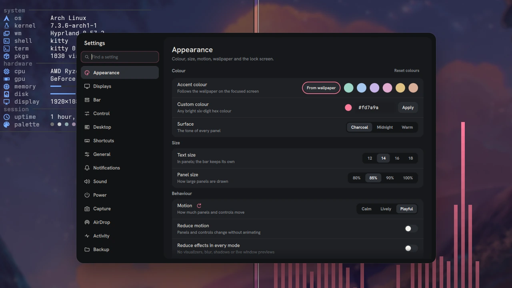<br><sub>Settings</sub></td>
  </tr>
</table>

## Install

```sh
git clone https://github.com/TurcanS/shale ~/src/shale && cd ~/src/shale
./install.sh
```

You need Arch Linux, Hyprland 0.56+ with a Lua config (`~/.config/hypr/hyprland.lua`; `hyprland.conf` isn't supported), Quickshell 0.3.1+, systemd user services and PipeWire. [dependencies.txt](dependencies.txt) lists the packages. Missing hardware (battery, backlight, Bluetooth, Wi-Fi) just hides the related controls.

Shale is the bar and the notification daemon, so remove waybar, mako, dunst, swaync and the like from your autostart. To try it without installing: `quickshell --path shell.qml`.

<details>
<summary><b>What the installer does</b></summary>
<br>

It shows the packages it wants (only the ones this machine needs) and installs them with `sudo pacman` after you confirm. Then it copies the shell to `~/.config/quickshell/shale`, adds `shale.lua` to `~/.config/hypr` with one line in `hyprland.lua` that loads it, and installs a `shale` command and a `shale.service` user unit. If one of Shale's shortcuts is already bound, it asks before replacing it. Every file it changes is backed up first.

It also works on a minimal Arch install: it adds Hyprland with its example config, portals, a polkit agent, fonts, PipeWire and the SDDM login screen if there's none, and the apps Shale opens things in, each only when nothing installed does that yet: Firefox for links, Thunar for folders (Super+E in a new config), Ristretto for screenshots, mpv for recordings and kitty as the terminal. Each becomes the default for what it opens unless you've chosen one. Where kitty and GTK apps have no settings yet, kitty gets Shale's Graphite colours and GTK apps a dark look; settings you already have, or change later, are never touched. It never replaces your network setup, power manager or wallpaper daemon. For the graphics it finds, it adds the firmware and Vulkan driver (AMD, Intel) and NVIDIA's own driver for your kernel (`nvidia-open`, the one NVIDIA ships for GTX 16 / RTX 20 and newer), unless a driver is installed already. On a laptop with hybrid graphics the desktop stays on the integrated GPU; start games on the NVIDIA one with `prime-run`.

If pacman can't download a package because its package lists are out of date, the installer offers to update the system (`pacman -Syu`) and try again.

Useful options: `--yes` (don't ask), `--no-packages` (shell only), `--no-login-screen`, `--no-drivers` (keep your own graphics drivers), `--no-apps` (no browser, file manager, viewer or player), `--no-app-config` (no kitty colours or GTK dark setting), `--wallpaper-shortcut` (binds Super+Shift+W), `--verbose`. `python3 scripts/install.py` previews the changes without writing anything.

Don't clone into `~/.config/quickshell/shale`; that's the install target.

</details>

### Update and uninstall

```sh
./install.sh --update       # git pull, reinstall, restart the shell
./install.sh --uninstall    # add --purge to also delete settings and history
```

When a new version is out, a dot appears on the control center button and the control center lists what changed; **Update now** runs `./install.sh --update` in a terminal. Shale asks GitHub every 12 hours; turn it off in Settings → General.

Uninstall puts back the files Shale replaced, removes the ones it added and takes only Shale's lines out of `hyprland.lua`, so your later edits stay. It doesn't remove packages; it prints the `pacman` command for the ones the installer added. To undo a single install instead: `python3 scripts/install.py --rollback ~/.local/state/shale/backups/<backup> --apply`.

## Features

| | What it does |
|---|---|
| **Bar** | Workspaces, window title, clock, media with a visualizer (optional `cava`), mic and screen-sharing indicator, tray, keyboard layout (with two or more), VPN, audio, Wi-Fi, battery and notifications. Tooltips on hover; can be hidden per output and over fullscreen apps. |
| **Launcher** | Apps with pins, open windows and actions (lock, restart, Wi-Fi, settings…). Type `6 * 7`, `10 km to mi`, `timer 10m tea` or `focus 40`; `:` for emoji, `/` for files, `?` to search the web, `>` to run a command. |
| **Control center** | Wi-Fi with per-network DNS (automatic, Cloudflare, Google or your own) and NetworkManager VPN/WireGuard connections, Bluetooth with per-device auto-connect, per-app volume, microphone, brightness, power profiles, do not disturb, stay awake, media with an equalizer. |
| **Notifications** | Grouped history, actions and optional persistence. |
| **Focus** | A timed session (25, 50 or 90 min, or `shale focus 40`) holds notifications and shows a countdown ring in the bar. When it ends, one card sums up what came in, grouped by app. Countdown timers too (`shale timer 10m Tea`). |
| **Lock screen** | PAM through ext-session-lock. The time is drawn in particles of light that gather, shift each minute and burst apart as you unlock; a classic clock or hyprlock if you prefer. |
| **Wallpapers** | Local folders, Wallhaven and Wallpapers.com, through hyprpaper, awww or swww. The accent color can follow the wallpaper. |
| **Clipboard** | History with image previews, color swatches and one-click opening of links and paths (cliphist). |
| **Calendar** | With weather from Open-Meteo, no API key. |
| **Overview** | Every workspace with window snapshots. |
| **Capture** | Screenshots, screen recording with system audio or microphone, color picker. |
| **System monitor** | Live CPU, memory, disks, network, GPUs, temperatures and fans (Ctrl+Shift+Esc), with the last five minutes already graphed when it opens. A sleeping laptop GPU is left asleep. |
| **Activity** | Opt-in, local-only app usage history with a yearly heatmap. |
| **AirDrop** | With the optional [AirDrop for Linux](#airdrop) `airdrop` command: send files or links to iPhones, iPads and Macs nearby (drop them on the panel or the bar key, or `shale airdrop send FILE…`), and receive Visible for 10 minutes or in the Background. Requests come as a card with Accept, Decline and Always, also on the lock screen. |
| **Make it yours** | Move, reorder or hide what the bar shows; pick its clock, workspace dots, tray icons and an edge-to-edge style. Arrange the control center's tiles and buttons, change any shortcut by pressing the new keys, and back up your settings to bring them to another computer. |

## Shortcuts

| Shortcut | Action | Shortcut | Action |
|---|---|---|---|
| <kbd>Super</kbd> <kbd>Space</kbd> | Launcher | <kbd>Super</kbd> <kbd>O</kbd> | Overview |
| <kbd>Super</kbd> <kbd>V</kbd> | Clipboard | <kbd>Super</kbd> <kbd>,</kbd> | Settings |
| <kbd>Super</kbd> <kbd>A</kbd> | Control center | <kbd>Print</kbd> / <kbd>Shift</kbd> <kbd>Print</kbd> | Region / output screenshot |
| <kbd>Super</kbd> <kbd>Shift</kbd> <kbd>A</kbd> | Activity | <kbd>Super</kbd> <kbd>Print</kbd> | Capture and recording |
| <kbd>Ctrl</kbd> <kbd>Shift</kbd> <kbd>Esc</kbd> | System monitor | <kbd>Super</kbd> <kbd>M</kbd> | Session menu |
| <kbd>Super</kbd> <kbd>N</kbd> | Notifications | <kbd>Super</kbd> <kbd>L</kbd> | Lock |

To change one, open Settings → Shortcuts, choose Change and press the new keys; it works right away. Keys your Hyprland config already uses are refused, so nothing gets bound twice. The calendar, color picker, do not disturb, focus and closing a panel can get a shortcut there too. Volume, brightness and media keys come from Hyprland's example config; Shale shows an OSD for them.

Everything is also a command: `shale launcher`, `shale system`, `shale screenshot region`, `shale page wifi`, `shale settings shortcuts`, `shale focus 50`, `shale dnd`, `shale lock`, `shale status`, `shale --version`. Run `shale help` for the list.

## AirDrop

<p align="center">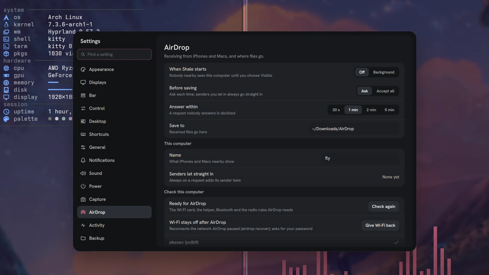</p>

Shale drives the `airdrop` command (AirDrop for Linux) through its `--json` interface; without it, AirDrop doesn't
show anywhere. Shale looks for it on your PATH and in `~/.local/bin`. Settings → AirDrop sets how it receives, where
files go, this computer's name and the senders let straight in, and checks what the Wi-Fi card needs.

- **Off**: nobody nearby sees this computer. **Visible**: like an iPhone's "Everyone for 10 Minutes"; Wi-Fi pauses
  meanwhile unless it already is on AirDrop's channel. **Background**: Wi-Fi stays on and Bluetooth listens; when an
  iPhone nearby opens AirDrop, this computer appears in its list for the transfer.
- Sending looks for devices only once something is chosen (it takes the radio too), and receiving waits meanwhile.
- `shale airdrop visible|background|off|toggle`, `shale airdrop send FILE…`, and `shale airdrop accept|decline` for
  the oldest request; the last two and the panel can get shortcuts in Settings → Shortcuts.
- Each session needs the airdrop helper's permission; install its polkit rule to stop being asked every time.

`scripts/install-airdrop.py` sets all of it up on an Arch laptop: it checks the Wi-Fi card (monitor mode),
Bluetooth and the regulatory domain, installs the build tools and libraries, builds and installs the command with
its root helper, OWL and polkit action as a package, adds the polkit rule and an `airdrop` group for you, and on a
MediaTek MT7921/MT7922 or a Realtek RTL8852BE builds and loads the patched driver. Without `--apply` it only shows what it would do.

```sh
python3 scripts/install-airdrop.py                     # preview
python3 scripts/install-airdrop.py --country DE --apply
```

`--source DIR` builds another source tree instead of Samara's, `--no-driver` skips the driver and
`--driver-at-boot` loads it at every boot. It ends with `airdrop doctor`.

## Files

| What | Where |
|---|---|
| Settings | `~/.config/shale/config.json` (Settings → Backup exports a copy) |
| Shortcuts changed in Settings | `~/.config/shale/shortcuts.lua`, read by `~/.config/hypr/shale.lua` |
| Activity, wallpaper choices, installer backups | `~/.local/state/shale/` |
| Cache | `~/.cache/shale/` |

Screenshots, recordings and wallpapers go to `Screenshots`, `Recordings` and `Wallpapers` in your XDG pictures and videos folders; change them in Settings.

Activity tracking is off until you turn it on in the Activity panel. It stores app IDs and time ranges (never window titles) in `activity.sqlite3`, and nothing leaves your machine.

<details>
<summary><b>Power profiles</b></summary>
<br>

Power modes work with power-profiles-daemon or tuned-ppd. Shale also ships TuneD profiles that go further (turbo, EPP, platform profile; power saver also drops the refresh rate and turns off blur and shadows). They need the `intel_pstate` or `amd-pstate-epp` driver:

```sh
sudo pacman -S --needed tuned tuned-ppd
sudo systemctl enable --now tuned.service tuned-ppd.service
python3 scripts/install-power.py --apply
```

Wi-Fi power saving can follow the power mode: off in Performance (lower latency, steadier throughput), on in
Balanced and Power saver. It works with either daemon and also sets the low-power mode of Realtek rtw89 cards:

```sh
python3 scripts/install-wifi-power.py --apply     # --remove --apply takes it out again
```

</details>

<details>
<summary><b>Troubleshooting</b></summary>
<br>

- `shale logs` shows the journal, `shale restart` restarts the shell.
- Settings → Diagnostics lists the tools and services Shale found.
- If the shell won't start, your apps and hyprlock still work.
- New enterprise Wi-Fi networks need a NetworkManager profile created elsewhere. Brightness covers laptop backlights only.

</details>

## Development

`shell.qml` creates a bar, panel host and overlays per output. `core/ShellState.qml` routes panels and exposes the `shell` IPC target, `core/Theme.qml` holds colors and motion, and `services/Services.qml` wraps Quickshell's native services. Everything else (Wi-Fi, Bluetooth pairing, power profiles, capture, settings, activity) goes through one Python helper, `helpers/backend.py`, which `core/Backend.qml` talks to over JSON lines on stdin/stdout:

```json
{"id": 1, "method": "wifi.list", "params": {}}
{"id": 1, "ok": true, "result": {"networks": [], "powered": true}}
```

Spacing, sizes and colors come from `core/Theme.qml`, and shared controls (lists, segmented choices, groups) from `components/`. Icons are outline SVGs in `assets/icons`; after adding or editing one, run `python3 scripts/build-icons.py` to regenerate `core/icons.js`, which lets an icon take any color.

Check a change against the running shell with `python3 scripts/check-live.py --installed`.

## Feedback

Bugs and feature requests go in [issues](https://github.com/TurcanS/shale/issues); questions, ideas and screenshots of your setup in [discussions](https://github.com/TurcanS/shale/discussions). Pull requests are welcome; run the check above first.

---

<sub>Weather by [Open-Meteo](https://open-meteo.com). Wallpapers from [Wallhaven](https://wallhaven.cc) and [Wallpapers.com](https://wallpapers.com); credit the artists when you share one. MIT licensed, see [LICENSE](LICENSE).</sub>
